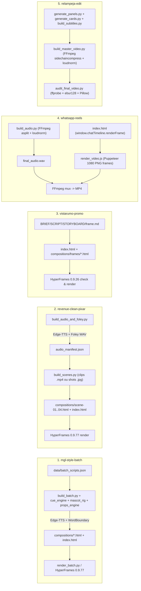

# Maquinadevideos

> Estúdio programático multi-pipeline para geração, montagem e renderização determinística de vídeos com **Python, FFmpeg, Edge-TTS, Puppeteer, GSAP e HyperFrames**.

> [!IMPORTANT]
> **Mídias privadas e vídeos produzidos não acompanham este repositório.**
> Todos os vídeos finalizados (`.mp4`), trilhas/vozes (`.mp3`, `.wav`, `.ogg`), clipes AI (`assets/clips/`), imagens geradas/capturas (`assets/shots/`, `capture/`, `validation_frames/`), arquivos `.zip` e rascunhos (`scratch/`) estão bloqueados no [`.gitignore`](.gitignore). O repositório entrega **todo o motor, composições, scripts, testes e assets leves de UI/fontes** para que você e sua IA possam estudar, reproduzir com suas próprias mídias/roteiros e evoluir o estúdio.

---

## Sumário

1. [Visão Geral e Comparativo dos 5 Pipelines](#1-visão-geral-e-comparativo-dos-5-pipelines)
2. [Arquitetura Geral do Monorepo](#2-arquitetura-geral-do-monorepo)
3. [Guia Detalhado de Cada Pipeline](#3-guia-detalhado-de-cada-pipeline)
   - [Pipeline 1 — `mgl-style-batch` (Lotes Verticais com Word-Cue + Rig 2.5D)](#pipeline-1--mgl-style-batch-lotes-verticais-com-word-cue--rig-25d)
   - [Pipeline 2 — `revenue-clean-pixar` (Storytelling Híbrido Video-First + Foley Procedural)](#pipeline-2--revenue-clean-pixar-storytelling-híbrido-video-first--foley-procedural)
   - [Pipeline 3 — `vistarumo-promo` (Promo 16:9 Declarativo em HyperFrames + GSAP)](#pipeline-3--vistarumo-promo-promo-169-declarativo-em-hyperframes--gsap)
   - [Pipeline 4 — `whatsapp-reels` (Simulação Determinística de Chat via Puppeteer + FFmpeg)](#pipeline-4--whatsapp-reels-simulação-determinística-de-chat-via-puppeteer--ffmpeg)
   - [Pipeline 5 — `relampeja-edit` (Edição de Talking-Head 100% Python + Pillow + FFmpeg)](#pipeline-5--relampeja-edit-edição-de-talking-head-100-python--pillow--ffmpeg)
4. [Estrutura de Diretórios e Controle de Mídias](#4-estrutura-de-diretórios-e-controle-de-mídias)
5. [Pré-requisitos e Instalação (Windows, macOS e Linux)](#5-pré-requisitos-e-instalação-windows-macos-e-linux)
6. [Guia Prático de Uso e Comandos](#6-guia-prático-de-uso-e-comandos)
7. [Testes Automatizados e Auditoria de Qualidade](#7-testes-automatizados-e-auditoria-de-qualidade)
8. [Guia para IAs e Roadmap de Melhorias](#8-guia-para-ias-e-roadmap-de-melhorias)
9. [Troubleshooting](#9-troubleshooting)

---

## 1. Visão Geral e Comparativo dos 5 Pipelines

O **Maquinadevideos** reúne cinco abordagens complementares de produção de vídeo via código — desde HTML/GSAP compilado em vídeo pelo HyperFrames até renderização frame-a-frame em Chromium/Puppeteer e edição não-linear pura via FFmpeg + Pillow.

| Pipeline | Pasta | Formato / Duração | Stack Principal | Motor de Render | Entradas | Saída Principal |
| --- | --- | --- | --- | --- | --- | --- |
| **MGL-Style Batch (v2)** | [`videos/mgl-style-batch/`](videos/mgl-style-batch/) | `1080x1920` (9:16), variável | Python, `edge-tts`, GSAP, SVG Rig | HyperFrames `0.9.77` | `data/batch_scripts.json` + `assets/audio/bgm.mp3` | `renders/<slug>.mp4` |
| **Pixar Hybrid Storytelling** | [`videos/revenue-clean-pixar/`](videos/revenue-clean-pixar/) | `1080x1920` (9:16), ~44.8s | Python, `edge-tts`, `wave`, GSAP | HyperFrames `0.9.77` | Clipes `.mp4` ou shots `.jpg` + `bgm.mp3` | `renders/04-revenue-clean-pixar.mp4` |
| **VistaRumo Promo** | [`videos/vistarumo-promo/`](videos/vistarumo-promo/) | `1920x1080` (16:9), 22.7s | HTML/CSS, GSAP, `<hf-audio-group>` | HyperFrames `0.9.26` | `index.html`, sub-composições, locuções + BGM | `renders/video.mp4` |
| **WhatsApp Reels** | [`videos/whatsapp-reels/`](videos/whatsapp-reels/) | `1080x1920` (9:16), 36.0s @ 30fps | HTML/JS, `puppeteer-core`, Python, FFmpeg | Chrome headless -> `image2pipe` FFmpeg | `SCRIPT` em `index.html` + `build_audio.py` + SFX/BGM | `reels_black_friday_vistarumo.mp4` |
| **Relampeja Edit** | [`videos/relampeja-edit/`](videos/relampeja-edit/) | `1080x1920` (9:16), 30.05s | Python, Pillow, legendas `.ass`, FFmpeg | FFmpeg `filter_complex` | Vídeo talking-head bruto + fotos + transcrição JSON | `relampeja_final.mp4` |

---

## 2. Arquitetura Geral do Monorepo



### Princípios Arquiteturais Compartilhados

1. **Timelines Determinísticas (Seek-Safe)**: tanto os projetos HyperFrames quanto `whatsapp-reels` (`window.__timelines["whatsapp-reels"]` / `window.chatTimeline.renderFrame(t)`) permitem pular diretamente para qualquer instante `t` e obter exatamente o mesmo estado DOM/visual — essencial para render paralelo e testes determinísticos.
2. **Sincronia por Timestamp Real de Fala (`WordBoundary` e `.ass`)**: em vez de cronometrar animações "no olho", os pipelines `mgl-style-batch` e `revenue-clean-pixar` capturam eventos `WordBoundary` do `edge-tts` e disparam troca de pose, *lip-sync*, legendas e elementos gráficos no instante exato da palavra.
3. **Grafos de Áudio FFmpeg Seguros**:
   - Sempre usar `asplit` explícito ao reutilizar o mesmo arquivo de SFX múltiplas vezes no `filter_complex` (evita erro de múltiplos links no mesmo pad de entrada).
   - Sempre passar `normalize=0` no `amix` para não atenuar o volume pela contagem de entradas.
   - Sempre normalizar a saída com `loudnorm=I=-14:TP=-1.5:LRA=11` (ou `sidechaincompress` quando há locução + trilha).

---

## 3. Guia Detalhado de Cada Pipeline

### Pipeline 1 — `mgl-style-batch` (Lotes Verticais com Word-Cue + Rig 2.5D)

Localizado em [`videos/mgl-style-batch/`](videos/mgl-style-batch/), é um compilador parametrizado que transforma um único JSON ([`data/batch_scripts.json`](videos/mgl-style-batch/data/batch_scripts.json)) em múltiplos vídeos verticais com narração neural, mascote articulado, cenários em 3 temas (`light`, `dark`, `lime`) e artes dinâmicas sincronizadas com a fala.

#### Módulos em [`videos/mgl-style-batch/scripts/`](videos/mgl-style-batch/scripts/)

- **[`cue_engine.py`](videos/mgl-style-batch/scripts/cue_engine.py)**:
  - `normalize_token(text)`: normaliza palavras sem acento e apenas alfanuméricas para casamento resiliente.
  - `resolve_word_cue(words, cue_word, fallback_ratio, scene_start, scene_dur, after_time=0.0)`: encontra o instante exato (em segundos absolutos) da palavra-gatilho na lista de `WordBoundary`; suporta gatilhos de múltiplas palavras e fallback proporcional caso não exista na frase.
  - `build_speech_envelopes(words, scene_start, min_gap=0.06)`: gera pulsos `[start, end, strength]` para abrir/fechar boca e balançar a cabeça durante a fala.
  - `group_caption_chunks(words, scene_start, scene_end, max_words=4)`: agrupa palavras em pílulas de legenda garantindo ausência de sobreposição temporal (`cur_end < next_start`).
- **[`mascot_rig.py`](videos/mgl-style-batch/scripts/mascot_rig.py)**:
  - Rig 2.5D em camadas SVG/DOM animáveis (`.mascot-shadow`, `.mascot-body-rig`, `.mascot-head-rig`, `.mascot-eyelids`, `.mascot-mouth`, `.mascot-arm-l`, `.mascot-arm-r`, `.mascot-prop`) com IDs únicos por cena para evitar colisão de `<defs>`.
  - **15 poses disponíveis**: `confident`, `broke`, `peek`, `magnify`, `point`, `laptop`, `shock`, `celebrate`, `marina_neutral`, `marina_clutch`, `marina_sad`, `marina_phone`, `marina_coffee`, `marina_relieved`, `marina_confident`.
  - Aceita override automático por imagem transparente se existir `assets/mascot/<pose>.png`.
  - [`generate_mascot_svgs.py`](videos/mgl-style-batch/scripts/generate_mascot_svgs.py) exporta todas as poses estáticas para `assets/mascot/*.svg`.
- **[`props_engine.py`](videos/mgl-style-batch/scripts/props_engine.py)**:
  - Gera componentes SVG/HTML parametrizáveis com atributos `data-cue-step`, `data-cue-word`, `data-cue-anim` (`pop-overshoot`, `grow-y`, etc.), `data-cue-sfx` e `data-cue-fallback`.
  - Suporta os tipos: `split-wheel-checklist`, `comparison_doors`, `versus_grid`, `doors-platforms`, `door-crowd`, `cards_stack`, `checklist`, `spy-table`, `flow_steps` / `flow-nodes` (com `cue-stroke-draw`), `bar_chart` / `bar-chart-cta`, `metrics_board` (`cue-count-up`), `product_shelf`, `offer_showcase`, `elevator_incident` e `revenue_clean_showcase`.
- **[`build_batch.py`](videos/mgl-style-batch/scripts/build_batch.py)**:
  - Lê `data/batch_scripts.json` (aceita argumentos opcionais: `[slug]` para filtrar um vídeo e `--reuse` para reutilizar MP3/JSON já sintetizados sem chamar o `edge-tts`).
  - Sintetiza cada cena via `edge_tts.Communicate(..., boundary="WordBoundary")`, mede a duração real via `ffprobe`, ajusta/faz loop da trilha de fundo via `ffmpeg` (`ensure_looped_bgm` -> `bgm_fit.mp3`), compila `compositions/<slug>.html` + `index.html` (para o vídeo `primary` ou primeiro da lista) e grava `data/batch_manifest.json`.
- **[`render_batch.py`](videos/mgl-style-batch/scripts/render_batch.py)**:
  - Lê `data/batch_manifest.json` e executa `npx --yes hyperframes@0.9.77 render` em sequência. Aceita `[slug]` e `[quality]` (padrão `looks`), com resolução cross-platform do executável `npx`.

#### Schema simplificado de `data/batch_scripts.json`

```json
{
  "voice": "pt-BR-AntonioNeural",
  "rate": "+18%",
  "bgm": "assets/audio/bgm.mp3",
  "videos": [
    {
      "slug": "meu-novo-video",
      "title": "Título do Vídeo",
      "primary": true,
      "scenes": [
        {
          "id": "s1-hook",
          "theme": "light",
          "pose": "confident",
          "pose_cues": [{ "word": "modela", "pose": "point" }],
          "prop": "split-wheel-checklist",
          "propData": { "cues": ["vende", "modela", "funciona"] },
          "sfx": "whoosh-short",
          "headline": {
            "mode": "split",
            "left": ["reinventando", "a roda"],
            "right": ["modelando", "o que vende"],
            "rightHighlightLine": 0,
            "highlightCue": "modela"
          },
          "narration": "Tem gente reinventando a roda, e tem gente que vende e modela o que já funciona."
        }
      ]
    }
  ]
}
```

---

### Pipeline 2 — `revenue-clean-pixar` (Storytelling Híbrido Video-First + Foley Procedural)

Localizado em [`videos/revenue-clean-pixar/`](videos/revenue-clean-pixar/), combina vídeos curtos gerados por IA (ou imagens estáticas com movimento Ken Burns em fallback), vozes multi-personagem via `edge-tts`, efeitos sonoros **Foley sintetizados matematicamente em Python** e tracking de rótulo SVG em GSAP sobre o produto.

#### Etapas em [`videos/revenue-clean-pixar/scripts/`](videos/revenue-clean-pixar/scripts/)

1. **[`build_audio_and_foley.py`](videos/revenue-clean-pixar/scripts/build_audio_and_foley.py)**:
   - Sintetiza 7 falas em PT-BR com vozes distintas (`pt-BR-ThalitaMultilingualNeural` e `pt-BR-FranciscaNeural`) e `WordBoundary`.
   - Gera 4 arquivos WAV (44.1 kHz, 16-bit mono) procedurais usando apenas `math`, `random`, `struct` e `wave`:
     - `foley_elevator_ding.wav` (sino bitonal 880 Hz + 1174.66 Hz)
     - `foley_leather_squeeze.wav` (fricção de alça de couro filtrada)
     - `foley_chair_slide.wav` (deslize de cadeira na madeira)
     - `foley_tape_peel.wav` (fita adesiva sendo puxada na abertura da caixa)
   - Cria `bgm_45s.mp3` com `ffmpeg` (se `assets/audio/bgm.mp3` existir localmente) e consolida todos os tempos/palavras em `assets/audio/generated/audio_manifest.json`.
2. **[`build_scenes.py`](videos/revenue-clean-pixar/scripts/build_scenes.py)**:
   - Lê `audio_manifest.json` e gera 4 sub-composições HyperFrames (`compositions/scene-01-elevator.html` até `scene-04-unboxing.html`) + `index.html` (`1080x1920`, `44.8s`), incluindo automação de volume do BGM (abafamento de 0.5s no momento dramático do elevador) e legendas sincronizadas.
   - **Estratégia Video-First (`render_shot_media`)**:
     - Se `assets/clips/shot_<id>.mp4` existir localmente, injeta `<video data-start=... data-duration=... data-playback-rate=... muted playsinline>` controlado de forma determinística pelo HyperFrames.
     - Se o `.mp4` não existir, faz fallback automático para `.jpg">` com animação GSAP de câmera.

---

### Pipeline 3 — `vistarumo-promo` (Promo 16:9 Declarativo em HyperFrames + GSAP)

Localizado em [`videos/vistarumo-promo/`](videos/vistarumo-promo/), é uma peça publicitária widescreen (`1920x1080`, `22.7s`) escrita diretamente em HTML/CSS/GSAP no padrão **HyperFrames (`0.9.26`)**, sem geradores Python.

- **Documentação de pré-produção incluída**: [`BRIEF.md`](videos/vistarumo-promo/BRIEF.md), [`SCRIPT.md`](videos/vistarumo-promo/SCRIPT.md), [`STORYBOARD.md`](videos/vistarumo-promo/STORYBOARD.md) e o Design System [`frame.md`](videos/vistarumo-promo/frame.md).
- **Estrutura de composição**:
  - [`index.html`](videos/vistarumo-promo/index.html): timeline mestre com `<hf-audio-group id="voiceover">` (highpass 90 Hz + compressor), BGM com ducking/voiceover carve, master ceiling limiter e inclusão das sub-composições.
  - [`compositions/frames/`](videos/vistarumo-promo/compositions/frames/): `01-hook.html`, `02-products.html`, `03-lifestyle.html`, `04-cta.html`.
  - [`compositions/captions.html`](videos/vistarumo-promo/compositions/captions.html): camada de legendas sincronizadas.
- **Validação estrita**: `npm run check:vistarumo` executa `hyperframes@0.9.26 check --strict` (lint, layout, safe-zones, contraste WCAG AA e determinismo).

---

### Pipeline 4 — `whatsapp-reels` (Simulação Determinística de Chat via Puppeteer + FFmpeg)

Localizado em [`videos/whatsapp-reels/`](videos/whatsapp-reels/), renderiza um Reels vertical (`1080x1920`, `36.0s`, `30 fps`, `1080 frames`) simulando uma conversa real de WhatsApp no iOS (status bar, Dynamic Island, cabeçalho com status `online`/`digitando...`, animação de digitação na barra de input, bolhas e rolagem automática suave + outro de produtos).

1. **[`build_audio.py`](videos/whatsapp-reels/build_audio.py)**:
   - Define `SCRIPT_EVENTS` (timings de `send`, `receive`, `impact`) e `TYPING_WINDOWS` (janelas em que o cliente digita, gerando cliques sutis a cada `0.15s` via `compute_key_times()`).
   - Constrói um único `filter_complex` FFmpeg com `asplit`, `adelay`, `amix normalize=0` e `loudnorm=I=-14:TP=-1.5:LRA=11`, gerando `final_audio.wav`.
2. **[`index.html`](videos/whatsapp-reels/index.html)**:
   - Expõe `window.chatTimeline.renderFrame(t)` e `window.chatTimeline.getState()`, além do adaptador compatível com HyperFrames `window.__timelines["whatsapp-reels"]`.
   - Recalcula o DOM inteiramente a partir de `t` (`updateViewAtTime(t)`), garantindo idempotência total (buscar `t=15.0` depois de `t=30.0` produz exatamente o mesmo estado visual de buscar `t=15.0` no início).
3. **[`render_video.js`](videos/whatsapp-reels/render_video.js)**:
   - Executa `python build_audio.py`.
   - Abre `index.html` no Chrome headless via `puppeteer-core` (respeitando `process.env.CHROME_PATH` ou caminhos padrão Windows/macOS/Linux).
   - Captura 1080 screenshots PNG em memória e envia via pipe (`image2pipe`) direto para `ffmpeg` (`libx264 -crf 18 -pix_fmt yuv420p`) sem gravar 1080 PNGs no disco.
   - Faz mux com `final_audio.wav` gerando `reels_black_friday_vistarumo.mp4` e remove `temp_video.mp4`.
4. **[`test_preview_frames.js`](videos/whatsapp-reels/test_preview_frames.js)**:
   - Testa 6 timestamps chave (`0.8s`, `2.2s`, `15.0s`, `29.9s`, `31.5s`, `34.5s`), verifica determinismo (`stateA == stateB`), captura PNGs em `os.tmpdir()` validando tamanho > 10 KB e checa o contrato `window.__timelines["whatsapp-reels"]`.

---

### Pipeline 5 — `relampeja-edit` (Edição de Talking-Head 100% Python + Pillow + FFmpeg)

Localizado em [`videos/relampeja-edit/`](videos/relampeja-edit/), automatiza a edição completa de um vídeo gravado em câmera (talking-head) sem usar navegador ou HTML.

Ordem de execução em [`videos/relampeja-edit/scripts/`](videos/relampeja-edit/scripts/):

1. **[`common.py`](videos/relampeja-edit/scripts/common.py)**: define a paleta Navy/Gold, resolução `1080x1920`, carregamento de fontes multiplataforma (`get_font`) e `resolve_asset()` (procura primeiro em `assets/`, depois no subprojeto, raiz e por último em `scratch/`).
2. **[`generate_panels.py`](videos/relampeja-edit/scripts/generate_panels.py)**: gera 6 faixas superiores/painéis PNG transparentes em `assets/panels/panel_1..6.png`.
3. **[`generate_cards.py`](videos/relampeja-edit/scripts/generate_cards.py)**: compõe 6 cards com fotos locais + badge em `assets/cards/card_*.png`.
4. **[`build_subtitles.py`](videos/relampeja-edit/scripts/build_subtitles.py)**: gera legendas `.ass` estilizadas com efeito karaokê (`\k`) palavra por palavra.
   - CLI: `python build_subtitles.py [--transcript caminho.json] [--speed-factor 1.15] [--output assets/captions.ass]`.
   - Possui `map_source_time_to_edited()` para remapear timestamps da transcrição original considerando os cortes (`DEFAULT_TRIM_SEGMENTS`) e a aceleração (`1.15x`).
5. **[`build_master_video.py`](videos/relampeja-edit/scripts/build_master_video.py)**: executa um único `ffmpeg` que:
   - Corta e concatena 4 segmentos do vídeo bruto (`trim`/`atrim` + `concat=n=4`);
   - Acelera `1.15x` (`setpts=PTS/1.15`, `atempo=1.15`);
   - Aplica color grading (`eq`, `unsharp`) e 4 *punch-ins* dinâmicos (`crop` 1.05x + `scale`);
   - Sobrepõe os 6 painéis e 6 cards com `fade` alpha, queima as legendas `.ass` e desenha uma barra de progresso animada na base;
   - Dispara 6 cliques de obturador (`asplit=6` + `adelay`), aplica ducking automático na trilha BGM usando a voz como gatilho (`sidechaincompress`) e finaliza com `loudnorm=I=-14:TP=-1.5:LRA=11`.
6. **[`audit_final_video.py`](videos/relampeja-edit/scripts/audit_final_video.py)**: valida resolução (`1080x1920`), duração (`29.0–31.5s`), LUFS via `ebur128` e extrai 8 frames em diretório temporário para conferir via Pillow se painéis e cards estão visíveis nos instantes corretos.

---

## 4. Estrutura de Diretórios e Controle de Mídias

```text
Maquinadevideos/
├── README.md                          # Este guia completo
├── AGENTS.md                          # Regras, invariantes e receitas para IAs
├── .gitignore                         # Bloqueia vídeos, áudios, renders, caches e mídias pessoais
├── package.json                       # Scripts unificados de teste e validação
├── pyproject.toml                     # Dependências Python + config pytest
├── requirements.txt                   # pillow, edge-tts
├── scripts/
│   └── validate_workspace.py          # Validador global (compatível com clone limpo)
├── tests/                             # Suíte Python unittest (16 testes)
│   ├── test_workspace.py
│   ├── test_mgl_v2.py
│   └── test_revenue_clean_pixar.py
└── videos/
    ├── mgl-style-batch/               # Pipeline 1: JSON -> Edge-TTS + SVG Rig + HyperFrames
    │   ├── assets/                    # Fontes .woff2, gsap.min.js e SVGs do mascote (áudios ficam fora do Git)
    │   ├── compositions/              # HTMLs compilados por slug
    │   ├── data/                      # batch_scripts.json e batch_manifest.json
    │   ├── scripts/                   # build_batch.py, cue_engine.py, mascot_rig.py, props_engine.py, render_batch.py
    │   ├── hyperframes.json
    │   └── package.json
    ├── revenue-clean-pixar/           # Pipeline 2: Video-first + Foley procedural + HyperFrames
    │   ├── assets/                    # Fontes .woff2 e gsap.min.js (clips/, shots/ e audio/generated/ fora do Git)
    │   ├── compositions/              # scene-01..04.html
    │   ├── scripts/                   # build_audio_and_foley.py, build_scenes.py
    │   ├── hyperframes.json
    │   └── package.json
    ├── vistarumo-promo/               # Pipeline 3: Composição declarativa HyperFrames 16:9
    │   ├── assets/                    # Fontes, gsap.min.js, imagens leves de UI (áudios e contact-sheets fora do Git)
    │   ├── compositions/              # captions.html + frames/01..04.html
    │   ├── BRIEF.md / SCRIPT.md / STORYBOARD.md / frame.md
    │   ├── hyperframes.json
    │   └── package.json
    ├── whatsapp-reels/                # Pipeline 4: Simulação WhatsApp via Puppeteer + FFmpeg
    │   ├── assets/                    # Imagens de UI WhatsApp, manifest.json (áudios fora do Git)
    │   ├── build_audio.py
    │   ├── render_video.js
    │   ├── test_preview_frames.js
    │   ├── index.html
    │   └── package.json
    └── relampeja-edit/                # Pipeline 5: Talking-head Python + Pillow + FFmpeg
        └── scripts/                   # common.py, generate_panels.py, generate_cards.py, build_subtitles.py, build_master_video.py, audit_final_video.py
```

### O que vem no Git vs. O que você gera ou fornece localmente

| Item | Versionado no Git? | Como obter ao clonar o repositório |
| --- | --- | --- |
| Scripts Python/JS, HTML/GSAP, JSONs de roteiro, fontes `.woff2`, SVGs, `gsap.min.js`, testes | **Sim** | Já vem no `git clone` |
| Vozes TTS + arquivos `WordBoundary` (`mgl-style-batch` e `revenue-clean-pixar`) | **Não** | Gerados automaticamente pelos scripts `build_batch.py` e `build_audio_and_foley.py` via `edge-tts` (requer internet) |
| Foleys WAV (`revenue-clean-pixar`) e painéis/cards/legendas `.ass` (`relampeja-edit`) | **Não** | Gerados localmente por `build_audio_and_foley.py`, `generate_panels.py`, `generate_cards.py` e `build_subtitles.py` |
| Vídeos renderizados (`.mp4`), `final_audio.wav`, `renders/`, `.hyperframes/` | **Não** | Gerados localmente ao rodar os comandos de build/render |
| Trilhas BGM, SFX externos, fotos pessoais, vídeos brutos (`relampeja.mp4`, `assets/clips/*.mp4`, `assets/shots/*.jpg`) | **Não** | Forneça os seus próprios arquivos nas respectivas pastas `assets/` (ver detalhes em cada pipeline) |

---

## 5. Pré-requisitos e Instalação (Windows, macOS e Linux)

### Dependências de Sistema

| Ferramenta | Versão Mínima | Para que é usada | Verificação |
| --- | --- | --- | --- |
| **Python** | `3.10+` | Todos os builders, `edge-tts`, Pillow e testes `unittest` | `python --version` |
| **Node.js & npm** | `18+` | Scripts da raiz, Puppeteer (`whatsapp-reels`) e `npx hyperframes` | `node --version` |
| **FFmpeg & FFprobe** | Qualquer build recente com `libx264`, `aac`, `libass` | Mixagem, `ebur128`, `loudnorm`, `sidechaincompress` e encode MP4 | `ffmpeg -version` e `ffprobe -version` |
| **Google Chrome / Chromium** | Atual | Renderização headless em `whatsapp-reels` e HyperFrames | `CHROME_PATH` (opcional se instalado no caminho padrão) |

### Passo a passo após clonar

```bash
git clone https://github.com/jvsouza01/Maquinadevideos.git
cd Maquinadevideos

# 1. Crie um ambiente virtual Python (recomendado)
python -m venv .venv

# Windows (PowerShell):
.venv\Scripts\Activate.ps1
# macOS / Linux:
# source .venv/bin/activate

# 2. Instale as dependências Python
pip install -r requirements.txt
# Opcional (testes com pytest e transcrição):
# pip install -e ".[dev,transcribe]"

# 3. Instale as dependências Node do whatsapp-reels (Puppeteer)
npm --prefix videos/whatsapp-reels install
```

> [!TIP]
> **Chrome em caminho customizado (`whatsapp-reels`):** se o Chrome/Chromium não estiver no caminho padrão do seu sistema operacional, defina a variável de ambiente `CHROME_PATH`:
> - **Windows PowerShell:** `$env:CHROME_PATH = "C:\caminho\para\chrome.exe"`
> - **macOS / Linux:** `export CHROME_PATH="/caminho/para/chrome"`

---

## 6. Guia Prático de Uso e Comandos

### Rodar toda a verificação do repositório

```bash
# Testes Python (16 testes cobrindo cue engine, rigs, props, FFmpeg filter graphs e media fallback)
npm run test:python

# Teste determinístico de frames do WhatsApp Reels (requer npm install em videos/whatsapp-reels)
npm run test:whatsapp

# Auditoria completa do workspace (arquivos renderizados presentes + Python + WhatsApp)
npm run validate
```

### Pipeline 1 (`mgl-style-batch`)

```bash
cd videos/mgl-style-batch

# 1. (Requer internet + assets/audio/bgm.mp3) Gera vozes edge-tts, WordBoundary e HTMLs
python scripts/build_batch.py

# Para recompilar apenas 1 vídeo reutilizando MP3s já baixados:
python scripts/build_batch.py 01-ranking-ia-validados --reuse

# 2. Abre preview interativo no HyperFrames Studio
npm run dev

# 3. Valida lint, layout, safe-zones e contraste
npm run check

# 4. Renderiza um vídeo ou todo o lote definido em data/batch_manifest.json
npm run render
python scripts/render_batch.py
# Ou filtrando slug e qualidade ("fast" / "looks"):
python scripts/render_batch.py 01-ranking-ia-validados looks
```

### Pipeline 2 (`revenue-clean-pixar`)

```bash
cd videos/revenue-clean-pixar

# 1. Coloque seus clipes em assets/clips/shot_*.mp4 (ou imagens em assets/shots/) e assets/audio/bgm.mp3
# 2. Gera vozes + Foley WAV + 4 sub-composições + index.html
npm run build

# 3. Preview, check e render
npm run dev
npm run check
npm run render
```

### Pipeline 3 (`vistarumo-promo`)

```bash
# Na raiz do repositório (requer assets/audio/*.mp3 e assets/sfx/*.mp3 locais para render completo):
npm run check:vistarumo
npm --prefix videos/vistarumo-promo run dev
npm --prefix videos/vistarumo-promo run render
```

### Pipeline 4 (`whatsapp-reels`)

```bash
# Teste rápido determinístico em 6 timestamps (não precisa de áudio MP3/WAV):
npm run test:whatsapp

# Mixar apenas o áudio (requer assets/track_berool.mp3 e assets/sfx_*.wav):
python videos/whatsapp-reels/build_audio.py

# Render completo (áudio + 1080 frames via Chrome + mux FFmpeg):
npm --prefix videos/whatsapp-reels run render
```

### Pipeline 5 (`relampeja-edit`)

```bash
cd videos/relampeja-edit/scripts

# 1. Gere painéis e cards (requer fotos em assets/ ou scratch/)
python generate_panels.py
python generate_cards.py

# 2. Gere legendas karaokê .ass (opcionalmente passe um JSON de transcrição)
python build_subtitles.py --speed-factor 1.15 --output ../assets/captions.ass
# Exemplo com JSON próprio:
# python build_subtitles.py --transcript caminho/transcript.json --speed-factor 1.15

# 3. Monte o vídeo final (requer vídeo bruto + trilha BGM)
python build_master_video.py

# 4. Audite resolução, duração, LUFS e frames dos cards/painéis
python audit_final_video.py
```

---

## 7. Testes Automatizados e Auditoria de Qualidade

A suíte em [`tests/`](tests/) foi projetada para **não depender das mídias privadas do autor**, funcionando tanto localmente quanto em um clone limpo:

| Arquivo | O que valida |
| --- | --- |
| [`tests/test_workspace.py`](tests/test_workspace.py) | Grafo FFmpeg do `whatsapp-reels` (`asplit`, `normalize=0`, `loudnorm`, `compute_key_times`), formatação/escalonamento `.ass`, remapeamento de transcrição com cortes (`map_source_time_to_edited`), `sidechaincompress` do `relampeja-edit` e resolução de assets `assets/` -> `scratch/`. |
| [`tests/test_mgl_v2.py`](tests/test_mgl_v2.py) | `resolve_word_cue` (casamento exato, sem acento e fallback), `group_caption_chunks` sem overlap temporal, camadas do `mascot_rig` (IDs únicos + Marina) e atributos `data-cue-*` do `props_engine`. |
| [`tests/test_revenue_clean_pixar.py`](tests/test_revenue_clean_pixar.py) | Estratégia *video-first* (`<video data-playback-rate>` quando o clipe `.mp4` existe), fallback automático para `` quando ausente e tracking do rótulo SVG na cena 4. |
| [`videos/whatsapp-reels/test_preview_frames.js`](videos/whatsapp-reels/test_preview_frames.js) | Renderização headless real no Chrome em 6 timestamps, idempotência de seek (`stateA == stateB`) e contrato `window.__timelines["whatsapp-reels"]`. |
| [`scripts/validate_workspace.py`](scripts/validate_workspace.py) | Audita quaisquer `.mp4`/`.wav` presentes localmente (`ffprobe` + `ffmpeg ebur128`), ignora graciosamente o que não existir em clone limpo e executa `unittest` + `test_preview_frames.js`. |

---

## 8. Guia para IAs e Roadmap de Melhorias

Se você (ou seu agente de IA — Cursor, Antigravity, Claude Code, Codex, Copilot) vai melhorar este projeto, leia também [`AGENTS.md`](AGENTS.md) na raiz antes de editar qualquer arquivo.

### Sugestões de Evolução (Backlog para Próximas Versões)

1. **Parametrizar `whatsapp-reels` via JSON externo**: hoje o diálogo `SCRIPT` está dentro de [`videos/whatsapp-reels/index.html`](videos/whatsapp-reels/index.html) e os tempos espelhados em `SCRIPT_EVENTS` dentro de [`videos/whatsapp-reels/build_audio.py`](videos/whatsapp-reels/build_audio.py). Extrair uma única fonte de verdade (`script.json`) elimina duplicação de timestamps e permite gerar dezenas de Reels de chat em lote.
2. **CLI completa no `relampeja-edit`**: parametrizar `--input`, `--bgm`, `--output`, `--trim-segments` e `--panel-windows` em [`build_master_video.py`](videos/relampeja-edit/scripts/build_master_video.py) para reutilizar o pipeline em qualquer vídeo talking-head sem editar o código.
3. **Investigar ganho de áudio no mux final do `whatsapp-reels`**: o `final_audio.wav` sai normalizado em `-14.5 LUFS`, mas vale validar os parâmetros de mux AAC no [`render_video.js`](videos/whatsapp-reels/render_video.js) para garantir loudness consistente após o encode final.
4. **Padronizar versão do HyperFrames**: atualizar [`videos/vistarumo-promo/package.json`](videos/vistarumo-promo/package.json) de `0.9.26` para `0.9.77` (testando antes com `check --strict`).
5. **Transcrição automática integrada no `relampeja-edit`**: conectar Whisper (`faster-whisper` ou API) para gerar automaticamente o JSON de palavras aceito por `--transcript` em [`build_subtitles.py`](videos/relampeja-edit/scripts/build_subtitles.py).
6. **Gerador de novos pipelines / templates**: criar um CLI unificado na raiz para inicializar um novo projeto de vídeo já com `hyperframes.json`, fontes locais, pasta `assets/` e testes determinísticos.

---

## 9. Troubleshooting

- **`ffmpeg` ou `ffprobe` não encontrado**: instale o FFmpeg completo (com `libx264`, `aac` e `libass`) e garanta que a pasta `bin` esteja no `PATH` do sistema.
- **`Chrome executable not found` no `whatsapp-reels`**: instale o Google Chrome/Chromium ou defina `CHROME_PATH` apontando para o executável.
- **Erro de rede no `edge-tts`**: `build_batch.py` e `build_audio_and_foley.py` usam o serviço online do Microsoft Edge TTS para sintetizar vozes novas. Depois de geradas uma vez, use `--reuse` no `mgl-style-batch` para recompilar offline.
- **Fontes diferentes no Linux/macOS (`relampeja-edit`)**: [`common.py`](videos/relampeja-edit/scripts/common.py) procura `Segoe UI` / `Arial` no Windows e cai para `DejaVuSans` no Linux (`/usr/share/fonts/truetype/dejavu/DejaVuSans-Bold.ttf`). Se rodar no macOS, adicione os caminhos de `/System/Library/Fonts/` em `get_font()`.
- **Erro `npx hyperframes` sem cache**: na primeira execução, `npx --yes hyperframes@0.9.77` baixa o pacote da npm registry (requer internet na primeira vez).
